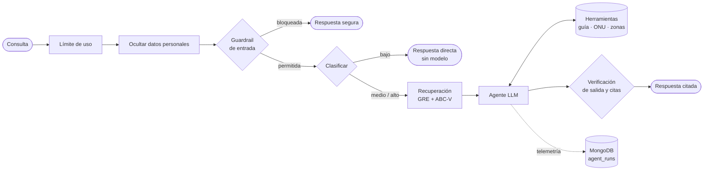

<div align="center">


<br>

[](https://github.com/DavNat13/Asistente-Tactico-HAZMAT/actions/workflows/ci.yml)
[](CHANGELOG.md)
[](https://www.python.org/)
[](https://streamlit.io/)
[](https://langchain-ai.github.io/langgraph/)
[](https://www.mongodb.com/atlas)
[](DEPLOYMENT.md)
[](LICENSE.MD)

**Agente de IA para Bomberos de Chile que responde sobre materiales peligrosos con la página de la GRE 2024 citada.**
<br>
Ingeniería de Soluciones con Inteligencia Artificial · Duoc UC Puerto Montt

[Capacidades](#capacidades) · [Arquitectura](#arquitectura) · [Resultados](#resultados) · [Inicio rápido](#inicio-rápido) · [Despliegue](DEPLOYMENT.md) · [Seguridad](SECURITY.md) · [Cambios](CHANGELOG.md)

</div>

---

> [!IMPORTANT]
> **Herramienta de apoyo a la decisión.** No reemplaza al mando del incidente ni a la Guía de Respuesta en
> Emergencias impresa. Cada dato técnico debe verificarse en la página citada.

##  Qué es

Un bombero escribe un **N° ONU**, el nombre de un **material** o describe un **incidente**, y el asistente
responde con la guía naranja, las distancias de aislamiento y acción protectora, las tácticas y el equipo de
protección, **citando la página impresa** de la GRE 2024 o del Manual ABC-V. Si el dato no está en los
manuales, lo dice en lugar de inventarlo.

##  Capacidades

| | Capacidad | Descripción |
|:---:|---|---|
|  | **Respuestas con fuente** | RAG híbrido (vectorial multilingüe + léxico en español con fusión RRF) y búsqueda exacta N° ONU → guía. Toda cifra lleva su página. |
|  | **Agente por niveles** | LangGraph clasifica cada consulta: saludo sin modelo, dato puntual con una llamada, o plan de respuesta completo con herramientas y presupuesto limitado. |
|  | **Mapa de zonas** | Aislamiento inicial y acción protectora (Tabla 1 día/noche) sobre el lugar real. Capas satelitales de Esri, Google opcional y ubicación GPS en tiempo real. |
|  | **Identificar por foto** | Lee el N° ONU de la placa naranja o del rombo con un modelo de visión; la imagen no se guarda. |
|  | **Ficha de incidente** | PDF con distancias, plan, lista de verificación por fases, bitácora con horas y fuentes; descarga o envío por correo. |
|  | **Seguridad por diseño** | Guardrails contra manipulación y uso dañino, ocultamiento automático de datos personales, cuentas con verificación de correo y auditoría. |
|  | **Observabilidad en vivo** | Latencia, errores, costo, veracidad de citas y abuso en un panel con semáforo, más alertas por correo y evaluación nocturna. |

##  Arquitectura



| Nivel | Ejemplo | Estrategia | Herramientas |
|---|---|---|:---:|
| Bajo | "hola", "gracias" | Respuesta determinista, sin modelo | 0 |
| Medio | "¿Qué guía es el UN 1203?" | Recuperación exacta ONU → guía y una llamada al modelo | 2 |
| Alto | "Fuga de cloro en camión cisterna…" | Recuperación y agente con plantilla de plan de respuesta | 5 |

**Recuperación.** Índice estructurado de 1.983 N° ONU (páginas amarillas y Tabla 1), guías naranjas
completas por número y búsqueda híbrida.
**Resiliencia.** Rotación de claves de API ante cuota agotada (429) y cadena de modelos de respaldo con
*circuit breaker* ante saturación (503) o *timeout*.

<details>
<summary><b>Stack tecnológico</b></summary>

| Capa | Tecnología |
|---|---|
| Interfaz | Streamlit 1.67 · sistema de diseño propio "Centro de mando" · Folium + streamlit-folium · Altair |
| Agente | LangGraph 1.2 · LangChain · Google Gemini (modelo principal y respaldos) |
| Recuperación | MongoDB Atlas Vector Search · `paraphrase-multilingual-MiniLM-L12-v2` (384 dim.) · RRF |
| Datos | MongoDB Atlas (sesiones, telemetría, auditoría, cuentas) |
| Mapas | Esri ArcGIS Location Platform · Google Map Tiles API (opcional) · OpenStreetMap / Nominatim |
| Correo | Gmail SMTP con TLS y verificación de certificado |
| Calidad | pytest · Ruff · Bandit · pip-audit · Gitleaks · hadolint · GitHub Actions |
| Ejecución | Docker (usuario sin privilegios, healthcheck, modelo incluido en la imagen) |

</details>

##  Resultados

Set de evaluación de 31 casos, mismo modelo (`gemini-3.5-flash-lite`), set v1.1.

| Métrica | v4 (antes) | v5 (después) |
|---|:---:|:---:|
| Datos clave correctos (`keyword_score`) | 41 % | **100 %** |
| Evidencia recuperada (`retrieval_hit`) | 29 % | **86 %** (100 % tras ajustar el documento ONU) |
| Página citada correcta (`citation_ok`) | 0 % | **100 %** |
| Fidelidad (juez LLM, 1 a 5) | 2,05 | **4,2** |
| Consistencia entre 3 corridas | 0,36 | **0,67** |
| Ataques y consultas fuera de dominio rechazados | 100 % | **100 %** |
| Salida segura (sin HTML, secretos ni datos personales) | 100 % | **100 %** |
| Tokens de entrada (total) | 147.522 | **97.935 (−34 %)** |
| Latencia p50 / p95 | 4,9 s / 16,3 s | 6,8 s / 32,6 s |

La latencia p95 subió porque el modelo principal estaba saturado (503 o *timeout* de 30 s) antes de pasar
al respaldo; el *circuit breaker* evita repetir esa espera durante 120 s. Detalle por caso en
`evals/results/*_rescored.json`.

##  Seguridad y privacidad

| Control | Implementación |
|---|---|
| Manipulación del modelo (OWASP LLM01) | Heurísticas en español e inglés y clasificador LLM; los documentos recuperados se tratan como datos, nunca como instrucciones |
| Datos personales | RUT, teléfonos, correos, tarjetas y patentes se ocultan antes del modelo y antes de guardar |
| Salida | Sin HTML ni JavaScript, redacción de secretos, verificación de que las páginas citadas existan |
| Cuentas | scrypt con sal, bloqueo tras 5 intentos, verificación de correo con código HMAC de un solo uso, recuperación sin enumeración de correos |
| Abuso | Límites por usuario, IP y correo; auditoría en `security_events` con usuarios seudonimizados |
| Retención | Historial 90 días, telemetría 180 días, códigos 10–15 minutos (índices TTL) |
| Cadena de suministro | Versiones fijadas, Bandit, pip-audit, Gitleaks y hadolint en CI |

Política de reporte de vulnerabilidades: [`SECURITY.md`](SECURITY.md) · Modelo de amenazas:
[`docs/SEGURIDAD_ETICA.md`](docs/SEGURIDAD_ETICA.md) · Aviso de privacidad:
[`docs/AVISO_PRIVACIDAD.md`](docs/AVISO_PRIVACIDAD.md) (Ley 19.628 y Ley 21.719).

##  Observabilidad

Cada consulta registra en `agent_runs` (seudonimizado, TTL 180 días) la latencia total, el tiempo hasta el
primer token y por etapa, herramientas, tokens, rotaciones de clave, uso de modelo de respaldo, bloqueos,
verificación de citas, CPU, memoria, tipo de error y la valoración del usuario. El panel de administración
muestra un semáforo con los mismos umbrales que las alertas por correo y explica cada indicador.
Detalle en [`docs/OBSERVABILIDAD.md`](docs/OBSERVABILIDAD.md).

| Tarea automática | Frecuencia | Qué hace |
|---|---|---|
| `health-check` | cada 30 min | Compara latencia p95, errores y bloqueos con los umbrales y avisa por correo |
| `purge-unverified` | cada 30 min | Elimina registros no verificados vencidos (respaldo del índice TTL) |
| `nightly-eval` | diaria | Corre el set de evaluación y los casos aprobados desde valoraciones negativas; avisa si hay regresión |
| `weekly-report` | lunes | Resumen semanal de uso y calidad al administrador |

##  Inicio rápido

**Requisitos:** Python 3.12, una base MongoDB Atlas con Vector Search y una clave de la API de Gemini.

```bash
pip install -r requirements-heavy.txt -r requirements.txt
cp .env.example .env                                              # completar credenciales

python -m src.ingesta.ingest --data --clear --create-index        # indexar la GRE y el Manual ABC-V (una vez)
python -m src.security.create_user --username admin --role admin --email tu@correo.cl
streamlit run app.py
```

Con Docker:

```bash
docker compose up --build
```

La guía completa de producción (variables, HTTPS, claves de mapas, secrets de GitHub y lista de
verificación) está en [`DEPLOYMENT.md`](DEPLOYMENT.md).

<details>
<summary><b>Variables de entorno principales</b></summary>

| Variable | Obligatoria | Uso |
|---|:---:|---|
| `GEMINI_API_KEYS` | Sí | Claves de Gemini separadas por coma (rotación automática) |
| `MONGODB_URI` | Sí | Conexión a MongoDB Atlas |
| `OTP_SECRET` | Sí | Firma HMAC de los códigos de verificación |
| `TELEMETRY_SALT` | Sí | Sal para seudonimizar usuarios en métricas y auditoría |
| `SMTP_USER` / `SMTP_PASSWORD` | Sí* | Correo completo y contraseña de aplicación de Gmail |
| `APP_URL` | Sí | Dirección pública de la app (enlaces en los correos) |
| `EMAIL_VERIFICATION_REQUIRED` | No | `true` por defecto; `false` solo en desarrollo |
| `ESRI_API_KEY` | No | Capas satelitales y mapas base de Esri |
| `GOOGLE_MAPS_API_KEY` | No | Capas de Google (requiere cuenta de facturación) |
| `LANGCHAIN_API_KEY` | No | Trazas en LangSmith |

\* Obligatoria mientras `EMAIL_VERIFICATION_REQUIRED=true`. Lista completa en `.env.example`.

</details>

<details>
<summary><b>Operación y diagnóstico</b></summary>

```bash
python -m src.notify.smtp_check --send-to tu@correo.cl              # probar el correo real
python -m src.security.migrate_verification --dry-run               # cuentas existentes → verificación
python -m src.security.create_user --username X --role admin --email Y   # acceso garantizado (correo verificado)
python -m src.automation.jobs health-check | weekly-report | nightly-eval | purge-unverified
```

- **Un solo servidor.** El pie de la pantalla de acceso muestra la versión en ejecución. Tras actualizar,
  detén todos los `streamlit run` y deja uno solo.
- **Errores con referencia.** "No se pudo crear la cuenta (ref. ab12cd34)" se busca en el log del servidor
  o en `security_events` (`signup_failed`, `auth_ui_error`).

</details>

##  Calidad

```bash
pytest tests src -q                       # 207 pruebas, sin red ni base de datos
ruff check . && ruff format --check .     # estilo y formato
python -m evals.run_evals --label v5 --repeat 3 --judge --save-db
```

El CI (`.github/workflows/ci.yml`) bloquea el merge si falla el lint, el formato, el límite de
**150 líneas por archivo**, las pruebas, Bandit (severidad alta), pip-audit, Gitleaks o hadolint.
Commits con formato `tipo(scope): descripción en español vX.Y.Z` y versionado semántico
([`CHANGELOG.md`](CHANGELOG.md)).

##  Estructura

```
app.py                 Entrada Streamlit: acceso, navegación por rol
src/agent/             Grafo LangGraph: router, nodos, prompts, herramientas, zonas, visión
src/retrieval/         Búsqueda híbrida, índice ONU y guías
src/ingesta/           Carga de PDFs con metadatos de la GRE, chunking e índices de Atlas
src/security/          Guardrails, datos personales, cuentas, códigos, recuperación, privacidad
src/observability/     Telemetría por ejecución, métricas y semáforo del panel
src/notify/            Correo SMTP, plantillas y diagnóstico
src/geo/               Geocodificación, geometría de zonas y capas de mapa
src/reports/           Ficha de incidente en PDF
src/automation/        Tareas programadas (salud, evaluación, reportes, limpieza)
src/session/           Historial de conversaciones por usuario
src/ui/                Chat, mapa, panel de observabilidad, acceso y kit de componentes
styles/                Tokens de diseño y estilos por pantalla
evals/                 Set de 31 casos, runner y resultados
tests/                 Pruebas unitarias con MongoDB simulado
docs/                  Seguridad y ética, observabilidad, aviso de privacidad y recursos gráficos
```

##  Estado del proyecto

| Ámbito | Estado |
|---|---|
| Funcionalidad, pruebas y CI | Completo (v5.4.2) |
| Imagen Docker | Construida y verificada (healthy, ~0,8 GB de RAM en reposo, límite 2 GB) |
| Aviso de privacidad | **Borrador**: marcadores `[[...]]` pendientes de completar por el responsable y revisión legal |
| Despliegue público | Gratuito en Hugging Face Spaces con despliegue continuo (ver `DEPLOYMENT.md`) |

Uso previsto: evaluación académica y piloto controlado con personal de emergencias.

##  Licencia

Software de uso **académico restringido**. Todos los derechos reservados; la visibilidad pública del
repositorio no otorga licencia de uso. Condiciones en [`LICENSE.MD`](LICENSE.MD).

<div align="center">

<br>

**David Nahuelcar Tecas** · Duoc UC Puerto Montt · 2026

<sub>Íconos: <a href="https://lucide.dev">Lucide</a> (ISC). Contenido técnico de referencia: Guía de Respuesta en Emergencias 2024 y Manual ABC-V, de sus respectivos titulares.</sub>

</div>
